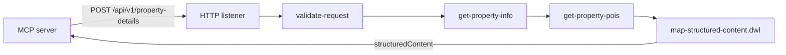

# ascott.mcp.get-property-details.xapi

Mule 4 experience API for MCP tool T-02 `get_property_details`. One HTTP listener takes the tool arguments, calls the property details API and the property POI API, and returns the tool's `structuredContent` as defined in `src/main/resources/schemas/structured-content.schema.json` (0.5.0).

This is a non-logged-in journey. The API takes no user, member or session data and has no authentication on the listener.



## Request

`POST http://<host>:8083/api/v1/property-details`, `Content-Type: application/json`. Contract: `src/main/resources/schemas/get-property-details-request.schema.json`.

| Field | Required | Default |
|---|---|---|
| `propertyCode` | one of code or name | – |
| `propertyName` | one of code or name | – |
| `checkin` | no | today + 1 day |
| `checkout` | no | checkin + 1 night |
| `adults` | no | 1 |
| `children` | no | 0 |
| `currency` | no | upstream currency, else SGD |
| `language` | no | en |
| `maxPois` | no | 5 (0 skips the POI call) |

Defaults and limits are in `application.properties` (`default.*`, `request.*`). Unknown fields are ignored. The optional `X-Correlation-ID` header is reused as the downstream `messageId` and returned on the response.

```bash
curl -s -X POST http://localhost:8083/api/v1/property-details \
  -H 'Content-Type: application/json' -d @examples/request.json
```

## Flows

All flows are in `src/main/mule/get-property-details.xml`.

| Flow | What it does |
|---|---|
| `get-property-details` | The listener. Runs the steps below in order and writes the audit log. |
| `validate-request` | `dwl/validate-request.dwl`: checks the arguments and applies defaults into `vars.request`. A failure returns 400. |
| `get-property-info` | POSTs `dwl/property-info-request.dwl` to the property details API. It sends `propertyName` only when there is no code. A 404 or empty result returns 404. |
| `get-property-pois` | POSTs `{version, language, channel, propertyCode: [code], maxPoisPerProperty}` to `getpropertypois`, using the code from the property details response. This step is optional: a failure or timeout is logged as `xapi.poi.unavailable` and the response omits `nearby[]`. |

The calls run in sequence because a request by name only gets the property code from the property details response.

## Mapping notes (`dwl/map-structured-content.dwl`)

- Upstream camelCase names from the PRD (`propertyName`, `brandlogo`, `perNightRatePrefCurr`, `facilityGroup`, …) are mapped to the schema's snake_case names. Where a source name is not certain, both spellings are accepted.
- Decimal strings become numbers. `countryCode` is upper-cased. Times must be `HH:mm[:ss]`. Dates are cut to `yyyy-MM-dd`.
- Optional fields with no value are omitted (null and blank strings are dropped). `brand_logo_url` and `property_type` fall back to `""`, as the schema allows.
- `availability_status` is `on_request` when there is no positive nightly rate. In that case no rates are sent.
- Facilities are de-duplicated by label (case-insensitive), within and across groups. Groups that end up empty are dropped.
- `nearby[]`: the POI group whose `propertyCode` matches is used. POIs missing a required field are dropped, and at most 5 are returned. `distance_minutes` is `distanceMinutes` when upstream sends it. Otherwise it is `ceil(distanceMetres / 80)` (`poi.walkingMetresPerMinute`).
- `asset_base_url` comes from `asset.baseUrl`.

## Run and check

Import into Anypoint Studio (Mule 4.12 EE, Java 17) and run. The only dependency is the HTTP connector; `ee:transform` ships with the EE runtime.

`python -I tests/check_contracts.py` (needs `pip install jsonschema`) validates the example requests and `examples/response.sample.json` against the schemas. `response.sample.json` is the expected output for the two `examples/upstream-*.sample.json` payloads, so it is the fixture to compare against when you run the app in Studio against a stub.

## T-04 room details and rates (`get-room-details.xml`)

`POST http://<host>:8083/api/v1/room-details`, for example with `examples/room-details-request.json`. The fields are the same as `get_property_details` (minus `maxPois`), plus `rooms` (1 to 9, default 1).

The flows, inline DataWeave and the error handler are in `get-room-details.xml`. Its upstream request config, `Room_Rates_HTTP`, is in `get-room-details-global-config.xml`. All of its properties are in `room-details.yaml`: the new `rooms.*` keys, plus the shared `http.*`, `app.*`, `default.*` and `request.*` keys. Neither XML file sets defaults, so those keys must be in the YAML the app loads. It shares only `HTTP_Listener` with T-02.

The response is flat. The property row (`property_code`, `property_name`, `country`, `city`, `currency`, `property_type`, `check_in_time`, `check_out_time`, `children_and_extra_bed*`, the four rates, and the stay) comes first. Then `apartments[]` has one row per requested room and apartment: `room_key` (`room0`), `room_index`, `apartment_index`, and then the apartment's own fields. Nested objects are flattened into prefixed snake_case keys, so `rate.perNight` becomes `rate_per_night`.

## Open items

- **Property details endpoint.** `property.*` currently points to the same Anypoint mocking link as the POI API, with path `/getpropertydetails`. This is an assumption. Set the real URL, credentials and request contract.
- **Response shapes are assumed.** `examples/upstream-property-details.sample.json` follows the PRD packet field names. The POI parser accepts `{properties: [{propertyCode, pois: [...]}]}`, a top-level `pois` array, or bare ODX POI objects. Confirm both against the real APIs.
- **Room rates endpoint.** `rooms.*` points to the mocking link with the assumed path `/getroomdetailsandrates`, and the body sends `propertyCode` as an array (like `getpropertypois`). Confirm both. The apartment fields are passed through as they come, so the row columns depend on the real response.
- **Credentials.** `client_id` and `client_secret` are plain properties holding the mock values. Move them to secure properties before deploying beyond local.
