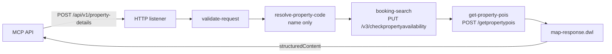

# ascott.mcp.property-details.xapi

Mule 4 experience API for MCP tool T-02 `get_property_details`. A plain HTTP listener (no APIkit) takes the tool arguments from the MCP API. It calls the booking search process API the same way `ODX_Booking_Search_Result_Apartment_Rate_Details_V3.xml` does, then calls the property POI API. It merges both into the tool's `structuredContent` (`src/main/resources/schemas/structured-content.schema.json`, 0.5.0).

This is a non-logged-in journey: no member, profile or session data, and no authentication on the listener.



## Project

| File | Purpose |
|---|---|
| `src/main/mule/global-config.xml` | Listener, `HTTP_Request_Bookingsearch_config` (same name as in the ODX flow), `Property_POI_HTTP`, `config.yaml` |
| `src/main/mule/get-property-details.xml` | The listener flow and its four sub-flows |
| `src/main/mule/error-handler.xml` | One error handler; every error becomes `{success: false, correlationId, error}` |
| `src/main/resources/config.yaml` | Every property the app reads |
| `src/main/resources/dwl/` | `validate-request`, `resolve-property-code`, `booking-search-request`, `select-property`, `map-response` |
| `src/main/resources/property-codes.json` | Name → code list for requests by `propertyName` (empty; see Open items) |

The only dependency is the HTTP connector. `ee:transform` ships with the EE runtime.

## Request

`POST http://<host>:8083/api/v1/property-details`, `Content-Type: application/json`. Contract: `src/main/resources/schemas/request.schema.json`.

| Field | Required | Default |
|---|---|---|
| `propertyCode` | one of code or name | – |
| `propertyName` | one of code or name | – |
| `checkin` (alias `checkinDate`) | no | today + 1 |
| `checkout` (alias `checkoutDate`) | no | checkin + 1 night |
| `adults` | no | 1 |
| `children` | no | 0 |
| `currency` | no | `property.currency` (SGD) |
| `language` | no | `property.language` (en) |
| `maxPois` | no | 5 (0 skips the POI call) |

The optional `X-Correlation-ID` header is sent downstream as `messageId` and returned on the response.

```bash
curl -s -X POST http://localhost:8083/api/v1/property-details \
  -H 'Content-Type: application/json' -d @examples/request.json
```

## Booking search call (from the ODX flow)

`PUT ${https.bookingsearchprocessapi.basePath}/v3/checkpropertyavailability` with headers `client_id`, `client_secret` and `messageId`, as in the ODX flow. The body follows the ODX "Request Payload" step. `examples/booking-search-request.json` shows the body for `examples/request.json`.

| Body field | Value |
|---|---|
| `messageId` | correlation ID |
| `language`, `currencyCode` | request, else `property.language` / `property.currency` |
| `propertyListing` | `false` (one property) |
| `propertyCode` | `[code]` |
| `checkinDate`, `checkoutDate` | request or defaults |
| `noOfRooms` | 1 |
| `noOfadults` / `noOfchildren` | strings, as ODX sends them; `noOfchildren` only when above 0 |
| `userCountry` | `https.bookingsearchprocessapi.userCountry` (SG). The ODX flow notes that an empty value makes the process API fail. |
| `isExcludePriceStartFrom` | `false` |
| `channel` | `https.bookingsearchprocessapi.channel` (`mobile`). Per the ODX flow, rate plans are tagged MOBILE/WEB. |

The member, promo, voucher and corporate fields from the ODX body are not sent. The response's `propertyList[]` entry for the requested code is mapped. A 404, or no entry in the list, returns 404 `PROPERTY_NOT_FOUND`.

## POI call

`POST /getpropertypois` with `{version: "v1", language, channel: "mcp", propertyCode: [code], maxPoisPerProperty}` and the `client_id`, `client_secret` and `messageId` headers, as in the supplied curl command. This step is optional: a failure is logged as `xapi.poi.unavailable` and the response leaves out `nearby[]`.

The mapping (POI → `nearby[]`):

| `nearby[]` field | POI source |
|---|---|
| `poi_id` | `poiId` |
| `title` | `poiName` |
| `category` | `poiCategory` |
| `type` | `poiType` |
| `icon_code` | `iconCode` |
| `coordinates` | `latitude` / `longitude`, converted to numbers |
| `address` | `poiAddress` |
| `distance_minutes` | `distanceMinutes`, else `ceil(distanceMetres / 80)` |

POIs that are missing a required field are dropped, and at most `maxPois` (5) are returned. The response can be `{properties: [{propertyCode, pois: [...]}]}` or a flat `pois` array.

## Response mapping (`dwl/map-response.dwl`)

- Source fields use the PRD camelCase names quoted in the schema (`propertyName`, `brandlogo`, `newPropertyThumbnail`, `perNightRatePrefCurr`, `facilityGroup`, `averageRatings`, `checkInTime`, …). Each is looked up at the top level of the `propertyList` entry first, then in its PRD block (`pricing`, `location`, `amenities`, `reviews`, `hotelInformation`).
- Decimal strings become numbers, `countryCode` is upper-cased, and times must be `HH:mm[:ss]`. Nulls and blank optional fields are left out.
- `availability_status` is `available` when there is a positive `perNightRatePrefCurr`. Otherwise it is `on_request` and no rates are sent.
- `based_on` is the stay and guests that were sent to the booking search.
- Facilities are de-duplicated by label, case-insensitive.
- If `thumbnail_url`, `location.address` or `location.coordinates` cannot be filled, the call returns 502 `UPSTREAM_DATA_INVALID` and names the missing fields. It does not return a card that breaks the schema.

## Errors

| Status | `error.code` | When |
|---|---|---|
| 400 | `BAD_REQUEST` | invalid arguments (all problems listed in `message`) |
| 404 | `PROPERTY_NOT_FOUND` | unknown code, or a name not found in `property-codes.json` |
| 502 | `UPSTREAM_DATA_INVALID` | booking search response unreadable or missing required fields |
| 502 | `DOWNSTREAM_UNAVAILABLE` | booking search HTTP error |
| 504 | `DOWNSTREAM_TIMEOUT` | booking search timeout (6 s) |
| 500 | `INTERNAL_ERROR` | anything else |

## Run and check

Import into Anypoint Studio (Mule 4.12 EE, Java 17). Fill in the `https.bookingsearchprocessapi.*` values in `config.yaml` from the app that runs the ODX flow, then run.

`python -I tests/check_contracts.py` (needs `pip install jsonschema`) checks that the XML is well-formed and the JSON parses. It also validates the example requests and `examples/response.sample.json` against the schemas. `response.sample.json` shows the target shape only. It was not produced by running the app.

## Open items

- **Booking search host and credentials.** `config.yaml` has placeholders. The ODX XML references `HTTP_Request_Bookingsearch_config` and `https.bookingsearchprocessapi.clientid/clientsecret`, but not their values.
- **v3 response field names.** The mapping assumes the `propertyList[]` entries use the PRD names. The flow logs the entry's field names (`xapi.bookingsearch.response`, names only) so this can be confirmed on the first real call.
- **Lookup by name.** The v3 search takes property codes only, so `propertyName` is resolved from `property-codes.json`, which is empty. Add `{"propertyCode": "...", "propertyName": "..."}` entries, or point the API at a lookup service if one exists.
- **Credentials.** `client_id` and `client_secret` are plain properties. Move them to secure properties before deploying beyond local.
